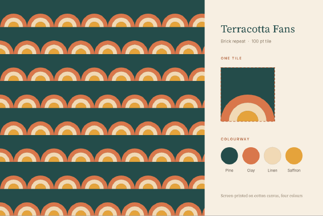

<!-- Generated by tools/gallery.mjs from showcase.yaml and build.json; do not edit. -->
# Terracotta Fan Pattern

[Vector](../README.md) › [Patterns](../README.md#patterns) · `pattern` `swatches` `seamless` `textile`

A mid-century fan motif made into a seamless pattern swatch, shown as a textile spec card with the tile and its colourway.



| | |
|---|---|
| Document | [terracotta-fan-pattern.kvector](terracotta-fan-pattern.kvector) (25 KB) |
| Contents | 1 artboard; 3 layers; 25 objects |
| Features | `vector.paint.patterns`, `vector.object.pattern`, `vector.paint.swatches`, `vector.shape.primitives`, `vector.object.pathfinder` |
| Built by | `kition-vector` @ `65d8d59892`: 61 commands in 23 ms |

## About

The motif is three concentric circles cropped to a 100 pt square with Pathfinder Crop over a
pine-green ground. `object.pattern.make` turns the two objects into the brick-by-row pattern
swatch "Terracotta Fans", which fills the left of the card through `paint.setFill {swatch}`; the
tile itself is scaled 200 % into the spec panel beside a dashed tile edge and the colourway.

## Checks

- `inspect.layers`: `{"count":3}`
- `inspect.layers.0`: `{"name":"Spec","children":{"count":14}}`
- `inspect.layers.1`: `{"name":"Tile","children":{"count":1,"all":{"kind":"Group","children":{"count":2}}}}`
- `inspect.layers.2`: `{"name":"Repeat","children":{"count":2}}`
- `inspect.layers.2.children.1`: `{"kind":"Rectangle","fill":"pattern Terracotta Fans"}`
- `results.pattern.name`: `"Terracotta Fans"`
- `results.patterns.patterns`: `{"count":1,"all":{"name":"Terracotta Fans","tileType":"brickByRow","width":100,"height":100,"artCount":2}}`
- diagnostics: none (the kit's check finds nothing wrong)
- the saved document opens again; the thumbnail matches `thumb.png` within the `render` tolerance

## Steps

<details><summary>61 commands (from <a href="showcase.yaml">showcase.yaml</a>)</summary>

```yaml
- command: layer.setProps
  params:
    name: Tile
- command: shape.rectangle
  params:
    x: 0
    y: 0
    width: 100
    height: 100
  as: tileBg
- command: paint.setStroke
  params:
    none: true
- command: paint.setFill
  params:
    color: "#244c4a"
- command: shape.ellipse
  params:
    x: 0
    y: 50
    width: 100
    height: 100
  as: fanA
- command: paint.setFill
  params:
    color: "#d9774b"
- command: shape.ellipse
  params:
    x: 15
    y: 65
    width: 70
    height: 70
  as: fanB
- command: paint.setFill
  params:
    color: "#f1d9b5"
- command: shape.ellipse
  params:
    x: 30
    y: 80
    width: 40
    height: 40
  as: fanC
- command: paint.setFill
  params:
    color: "#e5a33b"
- command: shape.rectangle
  params:
    x: 0
    y: 0
    width: 100
    height: 100
  as: crop
- command: select.set
  params:
    ids:
      - $fanA.id
      - $fanB.id
      - $fanC.id
      - $crop.id
- command: object.pathfinder.crop
  params: {}
  as: fan
- command: select.set
  params:
    ids:
      - $tileBg.id
      - $fan.ids.0
- command: object.pattern.make
  params:
    name: Terracotta Fans
    width: 100
    height: 100
    tileType: brickByRow
    brickOffset: 0.5
  as: pattern
- command: object.pattern.done
  params: {}
- command: select.set
  params:
    ids:
      - $tileBg.id
      - $fan.ids.0
- command: object.group
  params: {}
  as: tile
- command: object.scale
  params:
    sx: 200
    origin:
      - 0
      - 0
- command: object.move
  params:
    dx: 820
    dy: 250
- command: layer.new
  params:
    name: Repeat
  as: repeat
- command: layer.move
  params:
    ids:
      - $repeat.id
    target: 1
    place: below
- command: layer.setCurrent
  params:
    id: $repeat.id
- command: select.none
  params: {}
- command: shape.rectangle
  params:
    x: 0
    y: 0
    width: 760
    height: 800
  as: swatchFill
- command: paint.setFill
  params:
    swatch: Terracotta Fans
- command: shape.rectangle
  params:
    x: 760
    y: 0
    width: 440
    height: 800
  as: panel
- command: paint.setFill
  params:
    color: "#f7efe2"
- command: layer.new
  params:
    name: Spec
    top: true
  as: spec
- command: select.none
  params: {}
- command: text.create
  params:
    x: 820
    y: 120
    text: Terracotta Fans
    size: 40
    font: Source Serif 4
    color: "#244c4a"
- command: text.create
  params:
    x: 820
    y: 158
    text: Brick repeat  ·  100 pt tile
    size: 16
    font: Inter
    color: "#8a7a66"
- command: text.create
  params:
    x: 820
    y: 220
    text: ONE TILE
    size: 13
    font: Inter
    style: SemiBold
    color: "#b0623c"
  as: tileLabel
- command: text.setStyle
  params:
    id: $tileLabel.id
    tracking: 200
- command: shape.rectangle
  params:
    x: 820
    y: 250
    width: 200
    height: 200
  as: tileEdge
- command: paint.setFill
  params:
    none: true
- command: paint.setStroke
  params:
    color: "#b0623c"
- command: stroke.set
  params:
    weight: 2
    dash:
      - 8
      - 6
- command: select.none
  params: {}
- command: paint.setStroke
  params:
    none: true
- command: text.create
  params:
    x: 820
    y: 520
    text: COLOURWAY
    size: 13
    font: Inter
    style: SemiBold
    color: "#b0623c"
  as: cwLabel
- command: text.setStyle
  params:
    id: $cwLabel.id
    tracking: 200
- command: shape.ellipse
  params:
    x: 820
    y: 545
    width: 64
    height: 64
- command: paint.setFill
  params:
    color: "#244c4a"
- command: shape.ellipse
  params:
    x: 900
    y: 545
    width: 64
    height: 64
- command: paint.setFill
  params:
    color: "#d9774b"
- command: shape.ellipse
  params:
    x: 980
    y: 545
    width: 64
    height: 64
- command: paint.setFill
  params:
    color: "#f1d9b5"
- command: paint.setStroke
  params:
    color: "#d8c8b0"
- command: stroke.set
  params:
    weight: 1
- command: shape.ellipse
  params:
    x: 1060
    y: 545
    width: 64
    height: 64
- command: paint.setFill
  params:
    color: "#e5a33b"
- command: paint.setStroke
  params:
    none: true
- command: text.create
  params:
    x: 852
    y: 636
    text: Pine
    size: 14
    font: Inter
    color: "#5c5045"
  as: n1
- command: text.create
  params:
    x: 932
    y: 636
    text: Clay
    size: 14
    font: Inter
    color: "#5c5045"
  as: n2
- command: text.create
  params:
    x: 1012
    y: 636
    text: Linen
    size: 14
    font: Inter
    color: "#5c5045"
  as: n3
- command: text.create
  params:
    x: 1092
    y: 636
    text: Saffron
    size: 14
    font: Inter
    color: "#5c5045"
  as: n4
- command: text.setStyle
  params:
    ids:
      - $n1.id
      - $n2.id
      - $n3.id
      - $n4.id
    justify: center
- command: text.create
  params:
    x: 820
    y: 730
    text: Screen-printed on cotton canvas, four colours
    size: 15
    font: Source Serif 4
    color: "#8a7a66"
- command: select.none
  params: {}
- command: pattern.list
  params: {}
  as: patterns
```

</details>
