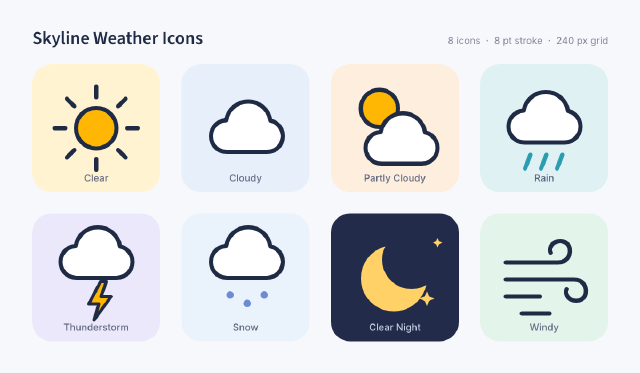

<!-- Generated by tools/gallery.mjs from showcase.yaml and build.json; do not edit. -->
# Weather Icon Set

[Vector](../README.md) › [Icons & Logos](../README.md#icons--logos) · `icons` `pathfinder` `strokes` `grid`

Eight duotone weather icons on a 240 px tile grid, their clouds united from circles and the moon cut with Minus Front.



| | |
|---|---|
| Document | [weather-icon-set.kvector](weather-icon-set.kvector) (41 KB) |
| Contents | 1 artboard; 3 layers; 51 objects |
| Features | `vector.shape.primitives`, `vector.object.pathfinder`, `vector.paint.stroke`, `vector.object.transform`, `vector.object.arrange`, `vector.text.edit` |
| Built by | `kition-vector` @ `65d8d59892`: 99 commands in 44 ms |

## About

One cloud is built with Pathfinder Unite from three circles and a rectangle, then copied into
five icons. The sun's rays are one line rotated with copies around the sun's centre and repeated
with Transform Again; the crescent is a circle minus a second circle. Every icon shares one
8 pt navy stroke with round caps and joins, set once as the default paint.

## Checks

- `inspect.layers`: `{"count":3}`
- `inspect.layers.0`: `{"name":"Labels","children":{"count":8,"all":{"kind":"Type"}}}`
- `inspect.layers.1`: `{"name":"Icons","children":{"count":29}}`
- `inspect.layers.1.children`: `{"any":{"kind":"Path","fill":"#ffd166","stroke":"None"}}`
- `inspect.layers.2`: `{"name":"Grid","children":{"count":11,"any":{"kind":"Rounded Rectangle","fill":"#232b4a"}}}`
- `results.cloud.ids`: `{"count":1}`
- `results.moon.ids`: `{"count":1}`
- `results.cloud3.ids`: `{"count":1}`
- `results.fonts`: `{"count":3,"all":{"status":"exact","noGlyph":0}}`
- diagnostics: none (the kit's check finds nothing wrong)
- the saved document opens again; the thumbnail matches `thumb.png` within the `render` tolerance

## Steps

<details><summary>99 commands (from <a href="showcase.yaml">showcase.yaml</a>)</summary>

```yaml
- command: layer.setProps
  params:
    name: Grid
- command: shape.rectangle
  params:
    x: 0
    y: 0
    width: 1200
    height: 700
  as: page
- command: paint.setStroke
  params:
    none: true
- command: paint.setFill
  params:
    color: "#f7f8fb"
- command: shape.rectangle
  params:
    x: 60
    y: 120
    width: 240
    height: 240
    radius: 36
- command: paint.setFill
  params:
    color: "#fff3d1"
- command: shape.rectangle
  params:
    x: 340
    y: 120
    width: 240
    height: 240
    radius: 36
- command: paint.setFill
  params:
    color: "#e6effa"
- command: shape.rectangle
  params:
    x: 620
    y: 120
    width: 240
    height: 240
    radius: 36
- command: paint.setFill
  params:
    color: "#fdeedd"
- command: shape.rectangle
  params:
    x: 900
    y: 120
    width: 240
    height: 240
    radius: 36
- command: paint.setFill
  params:
    color: "#dff1f3"
- command: shape.rectangle
  params:
    x: 60
    y: 400
    width: 240
    height: 240
    radius: 36
- command: paint.setFill
  params:
    color: "#ece8fb"
- command: shape.rectangle
  params:
    x: 340
    y: 400
    width: 240
    height: 240
    radius: 36
- command: paint.setFill
  params:
    color: "#eaf3fb"
- command: shape.rectangle
  params:
    x: 620
    y: 400
    width: 240
    height: 240
    radius: 36
- command: paint.setFill
  params:
    color: "#232b4a"
- command: shape.rectangle
  params:
    x: 900
    y: 400
    width: 240
    height: 240
    radius: 36
- command: paint.setFill
  params:
    color: "#e3f4ea"
- command: text.create
  params:
    x: 60
    y: 82
    text: Skyline Weather Icons
    size: 34
    font: Source Sans 3
    style: Semibold
    color: "#1f2a44"
- command: text.create
  params:
    x: 1140
    y: 82
    text: 8 icons  ·  8 pt stroke  ·  240 px grid
    size: 18
    font: Inter
    color: "#7a8399"
  as: meta
- command: text.setStyle
  params:
    id: $meta.id
    justify: right
- command: layer.new
  params:
    name: Icons
  as: icons
- command: select.none
  params: {}
- command: paint.setStroke
  params:
    color: "#1f2a44"
- command: stroke.set
  params:
    weight: 8
    cap: round
    join: round
- command: shape.ellipse
  params:
    x: 142
    y: 202
    width: 76
    height: 76
  as: sun
- command: paint.setFill
  params:
    color: "#ffb703"
- command: shape.line
  params:
    x1: 180
    y1: 182
    x2: 180
    y2: 162
  as: ray
- command: paint.setFill
  params:
    none: true
- command: object.rotate
  params:
    angle: 45
    origin:
      - 180
      - 240
    copy: true
- command: object.transformAgain
  params: {}
- command: object.transformAgain
  params: {}
- command: object.transformAgain
  params: {}
- command: object.transformAgain
  params: {}
- command: object.transformAgain
  params: {}
- command: object.transformAgain
  params: {}
- command: shape.ellipse
  params:
    x: 395
    y: 225
    width: 60
    height: 60
  as: c1
- command: paint.setFill
  params:
    color: "#ffffff"
- command: shape.ellipse
  params:
    x: 423
    y: 190
    width: 84
    height: 84
  as: c2
- command: shape.ellipse
  params:
    x: 470
    y: 225
    width: 60
    height: 60
  as: c3
- command: shape.rectangle
  params:
    x: 425
    y: 245
    width: 75
    height: 40
  as: c4
- command: select.set
  params:
    ids:
      - $c1.id
      - $c2.id
      - $c3.id
      - $c4.id
- command: object.pathfinder.unite
  params: {}
  as: cloud
- command: shape.ellipse
  params:
    x: 676
    y: 168
    width: 70
    height: 70
  as: sun2
- command: paint.setFill
  params:
    color: "#ffb703"
- command: select.set
  params:
    ids:
      - $cloud.ids.0
- command: object.move
  params:
    dx: 290
    dy: 22
    copy: true
  as: cloud2
- command: object.arrange.bringToFront
  params: {}
- command: select.set
  params:
    ids:
      - $cloud.ids.0
- command: object.move
  params:
    dx: 558
    dy: -18
    copy: true
  as: cloud3
- command: shape.line
  params:
    x1: 994
    y1: 290
    x2: 984
    y2: 316
- command: paint.setFill
  params:
    none: true
- command: paint.setStroke
  params:
    color: "#2a9db0"
- command: shape.line
  params:
    x1: 1024
    y1: 290
    x2: 1014
    y2: 316
- command: shape.line
  params:
    x1: 1054
    y1: 290
    x2: 1044
    y2: 316
- command: select.none
  params: {}
- command: paint.setStroke
  params:
    color: "#1f2a44"
- command: select.set
  params:
    ids:
      - $cloud.ids.0
- command: object.move
  params:
    dx: -282
    dy: 236
    copy: true
  as: cloud4
- command: path.create
  params:
    d: M188 528 L166 570 L185 570 L176 600 L208 556 L189 556 L199 528 Z
  as: bolt
- command: paint.setFill
  params:
    color: "#ffb703"
- command: stroke.set
  params:
    weight: 6
- command: select.set
  params:
    ids:
      - $cloud.ids.0
- command: object.move
  params:
    dx: 0
    dy: 236
    copy: true
  as: cloud5
- command: shape.ellipse
  params:
    x: 424
    y: 546
    width: 14
    height: 14
- command: paint.setFill
  params:
    color: "#6b8bd6"
- command: paint.setStroke
  params:
    none: true
- command: shape.ellipse
  params:
    x: 456
    y: 562
    width: 14
    height: 14
- command: shape.ellipse
  params:
    x: 488
    y: 546
    width: 14
    height: 14
- command: shape.ellipse
  params:
    x: 676
    y: 460
    width: 124
    height: 124
  as: moonDisc
- command: paint.setFill
  params:
    color: "#ffd166"
- command: shape.ellipse
  params:
    x: 716
    y: 432
    width: 110
    height: 110
  as: moonBite
- command: select.set
  params:
    ids:
      - $moonDisc.id
      - $moonBite.id
- command: object.pathfinder.minusFront
  params: {}
  as: moon
- command: shape.star
  params:
    cx: 800
    cy: 560
    radius1: 14
    radius2: 6
    points: 4
- command: paint.setFill
  params:
    color: "#ffd166"
- command: shape.star
  params:
    cx: 820
    cy: 455
    radius1: 9
    radius2: 4
    points: 4
- command: path.create
  params:
    d: M948 492 L1046 492 C1074 492 1076 452 1050 452 C1034 452 1028 466 1032 474
  as: wind1
- command: paint.setFill
  params:
    none: true
- command: paint.setStroke
  params:
    color: "#1f2a44"
- command: stroke.set
  params:
    weight: 8
    cap: round
    join: round
- command: path.create
  params:
    d: M948 524 L1076 524 C1104 524 1106 564 1080 564 C1064 564 1058 550 1062 542
- command: path.create
  params:
    d: M948 556 L1012 556
- command: path.create
  params:
    d: M978 588 L1030 588
- command: layer.new
  params:
    name: Labels
  as: labels
- command: select.none
  params: {}
- command: text.create
  params:
    x: 180
    y: 340
    text: Clear
    size: 18
    font: Inter
    style: Medium
    color: "#5d6680"
  as: l1
- command: text.create
  params:
    x: 460
    y: 340
    text: Cloudy
    size: 18
    font: Inter
    style: Medium
    color: "#5d6680"
  as: l2
- command: text.create
  params:
    x: 740
    y: 340
    text: Partly Cloudy
    size: 18
    font: Inter
    style: Medium
    color: "#5d6680"
  as: l3
- command: text.create
  params:
    x: 1020
    y: 340
    text: Rain
    size: 18
    font: Inter
    style: Medium
    color: "#5d6680"
  as: l4
- command: text.create
  params:
    x: 180
    y: 620
    text: Thunderstorm
    size: 18
    font: Inter
    style: Medium
    color: "#5d6680"
  as: l5
- command: text.create
  params:
    x: 460
    y: 620
    text: Snow
    size: 18
    font: Inter
    style: Medium
    color: "#5d6680"
  as: l6
- command: text.create
  params:
    x: 740
    y: 620
    text: Clear Night
    size: 18
    font: Inter
    style: Medium
    color: "#c9cfe6"
  as: l7
- command: text.create
  params:
    x: 1020
    y: 620
    text: Windy
    size: 18
    font: Inter
    style: Medium
    color: "#5d6680"
  as: l8
- command: text.setStyle
  params:
    ids:
      - $l1.id
      - $l2.id
      - $l3.id
      - $l4.id
      - $l5.id
      - $l6.id
      - $l7.id
      - $l8.id
    justify: center
- command: select.none
  params: {}
- command: text.fonts
  params: {}
  as: fonts
```

</details>
